<div align="center">

# arknights-plugin

**把罗德岛的数据，带到聊天里。**

基于森空岛 API 的 Yunzai Bot 明日方舟插件<br>
查询干员与时装资产、查看活动与卫戍战绩，也能完成日常签到与养成规划。

[](CHANGELOG.md)
[](LICENSE)
[](https://github.com/yoimiya-kokomi/Yunzai-Bot)

[效果展示](#效果展示) · [安装与绑定](#安装与绑定) · [命令指南](#命令指南) · [配置说明](#配置说明) · [更新日志](CHANGELOG.md)

</div>

[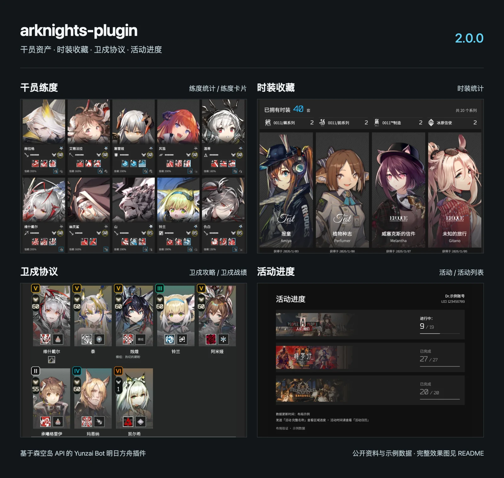](.github/images/overview.webp)

## 2.0.0 新变化

- **干员资产一目了然**：紧凑列表与五列立绘卡片，展示全部技能、专精、潜能、信赖和模组；支持星级、职业筛选与分页。
- **时装收藏有据可查**：统计已拥有时装和系列数量，按获得时间展示最近收藏，默认 8 套。
- **卫戍攻略与逐局战绩**：查看成型阵容、回合配置、盟约、装备和操作思路，技能与模组用图标呈现。
- **活动进度与时间分开查**：`活动` 查看账号关卡完成情况，`活动日历` 查看近期活动时间。

## 效果展示

组合图使用实际页面截图排版，点击图片可放大。下方按功能整理完整效果图；2.0.0 新功能使用公开资料与示例账号数据，其他图片沿用原 README 的历史示例。

### 干员资产与时装

<table>
<tr>
<td width="50%" align="center" valign="top"><strong>练度卡片</strong><br>立绘与练度分区，技能、专精和模组集中展示<br><br><a href=".github/images/operators-cards.webp">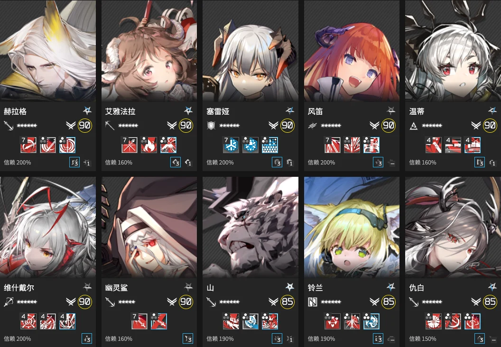</a></td>
<td width="50%" align="center" valign="top"><strong>时装统计</strong><br>收藏总数、系列分布与最近获得时间<br><br><a href=".github/images/skins.webp">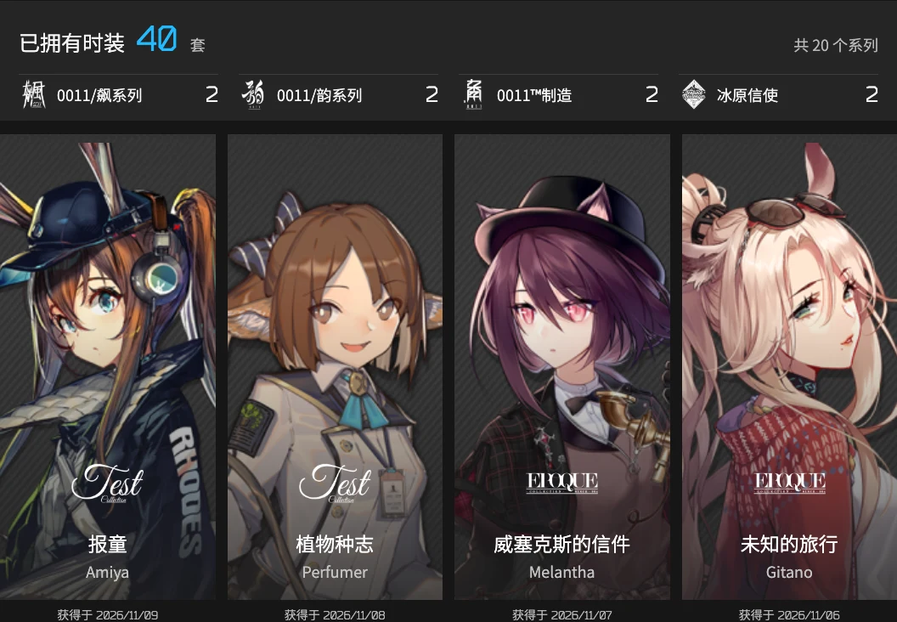</a></td>
</tr>
</table>

<details>
<summary>查看练度列表与更多养成效果</summary>

| 练度列表 | 干员详情 |
| :---: | :---: |
| [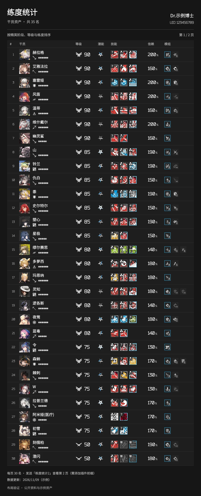](.github/images/operators-list.webp) | [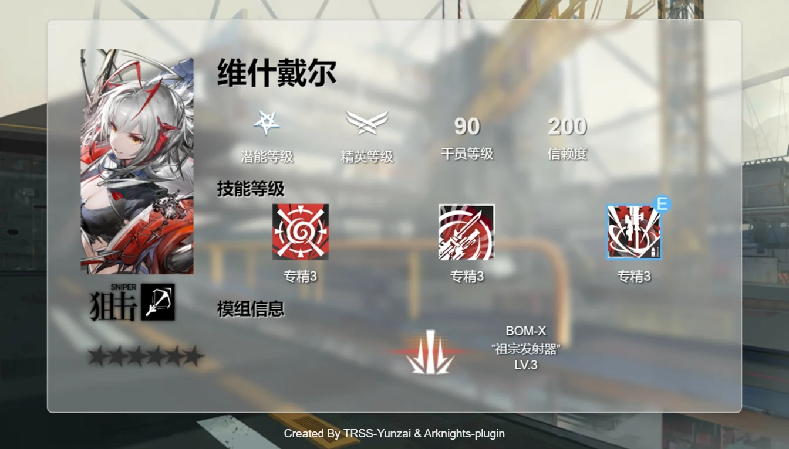](.github/images/operator.webp) |
| **BOX 练度分析** | **养成材料计算** |
| [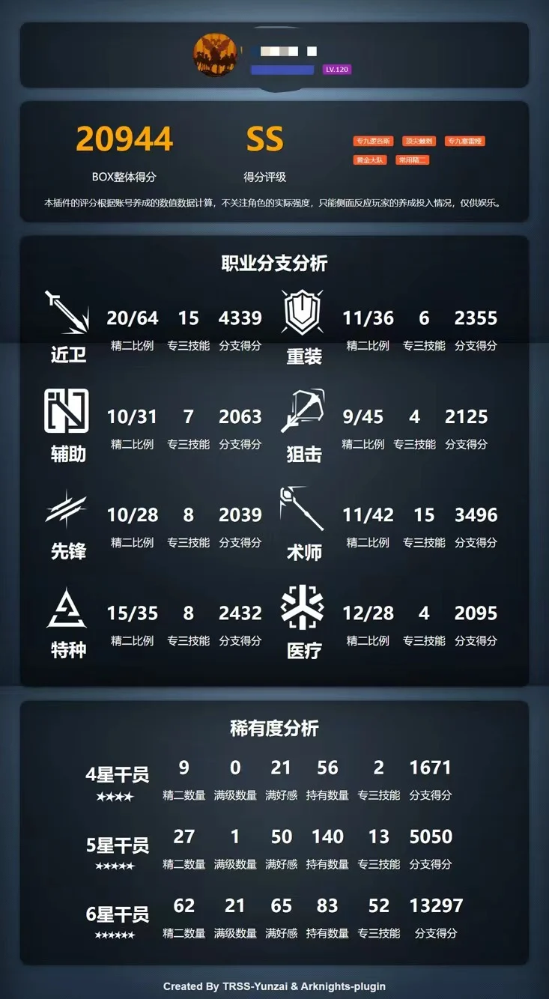](.github/images/box-analysis.webp) | [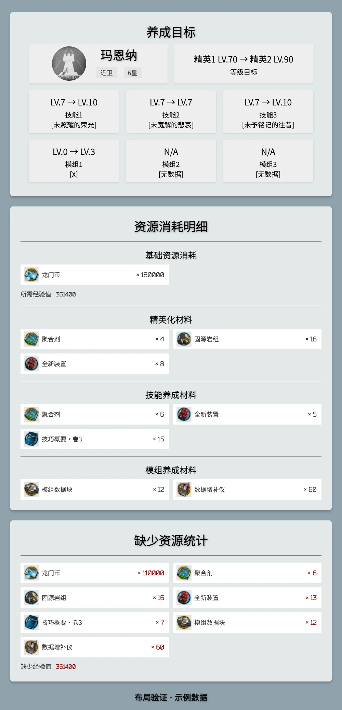](.github/images/materials.webp) |

[查看一图流养成统计效果](.github/images/training.webp)

</details>

### 卫戍协议与活动

<table>
<tr>
<td width="50%" align="center" valign="top"><strong>卫戍协议</strong><br>攻略与战绩共用图标阵容卡片<br><br><a href=".github/images/garrison-record.webp">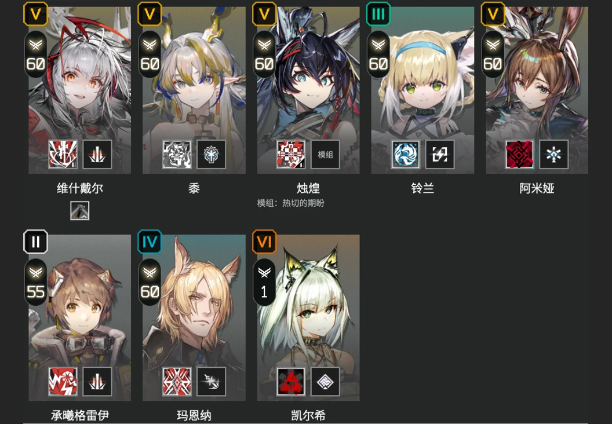</a></td>
<td width="50%" align="center" valign="top"><strong>活动进度</strong><br>快速区分进行中与已完成的活动<br><br><a href=".github/images/activity.webp">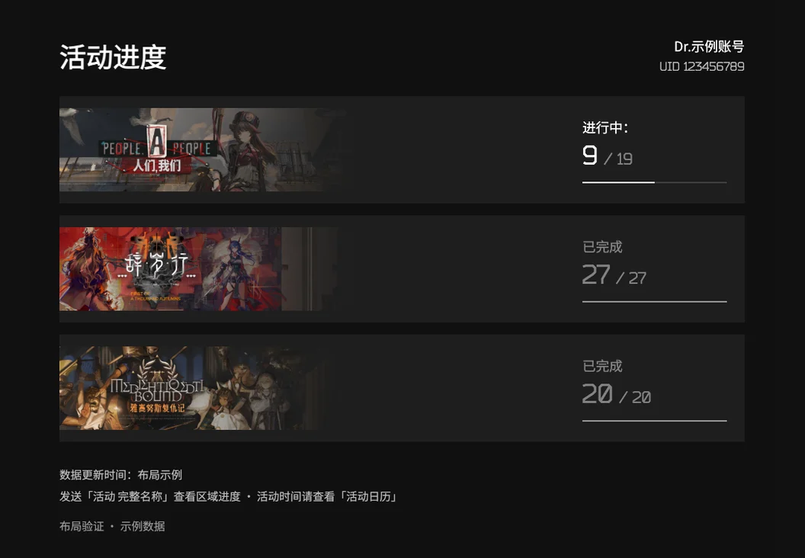</a></td>
</tr>
</table>

<details>
<summary>查看完整攻略、逐局战绩与公告效果</summary>

| 攻略详情 | 战绩详情 |
| :---: | :---: |
| [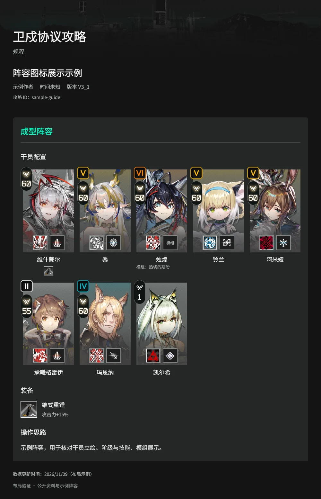](.github/images/garrison-guide.webp) | [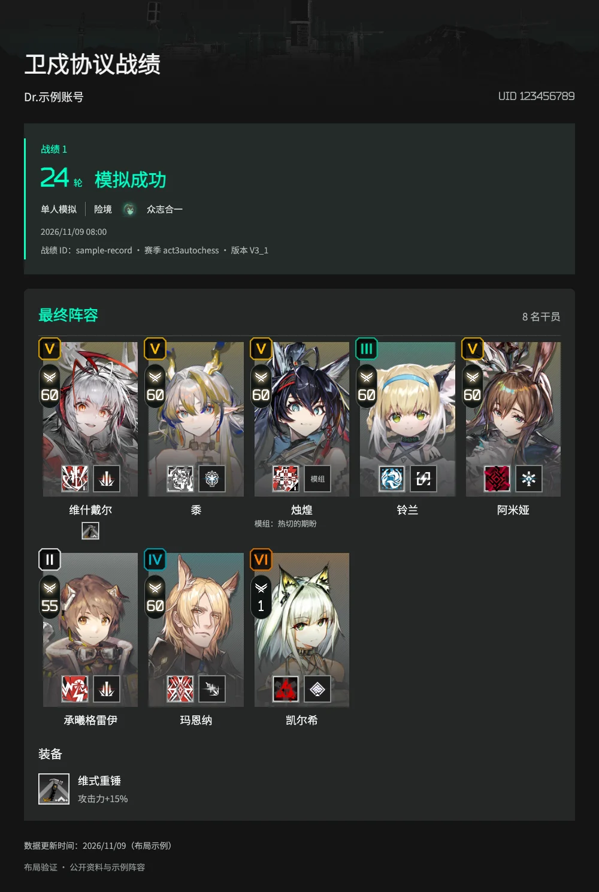](.github/images/garrison-record.webp) |

[查看官方公告效果](.github/images/announcement.webp)

</details>

<details>
<summary>查看博士便签与寻访记录效果</summary>

**博士便签** · 个人信息一图流

[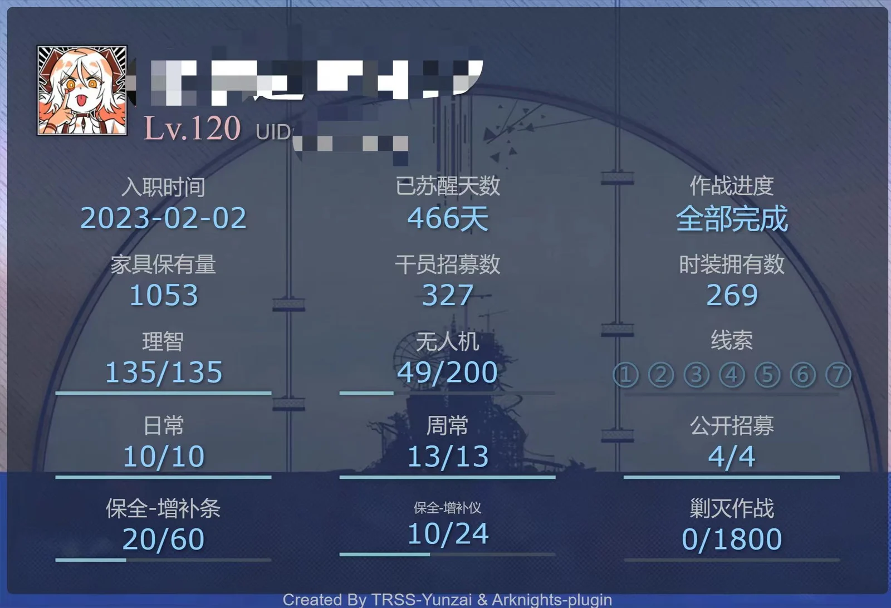](.github/images/profile.webp)

| 寻访记录 | 寻访分析 |
| :---: | :---: |
| [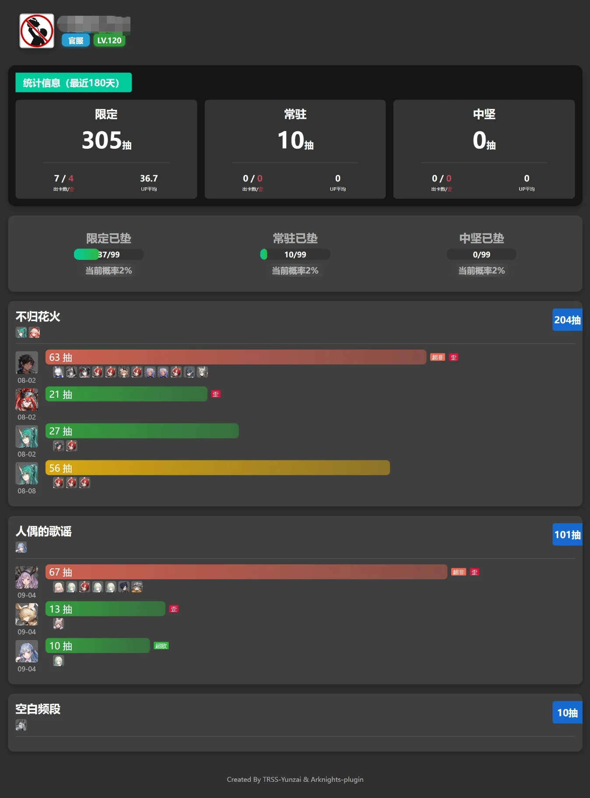](.github/images/recruit-record.webp) | [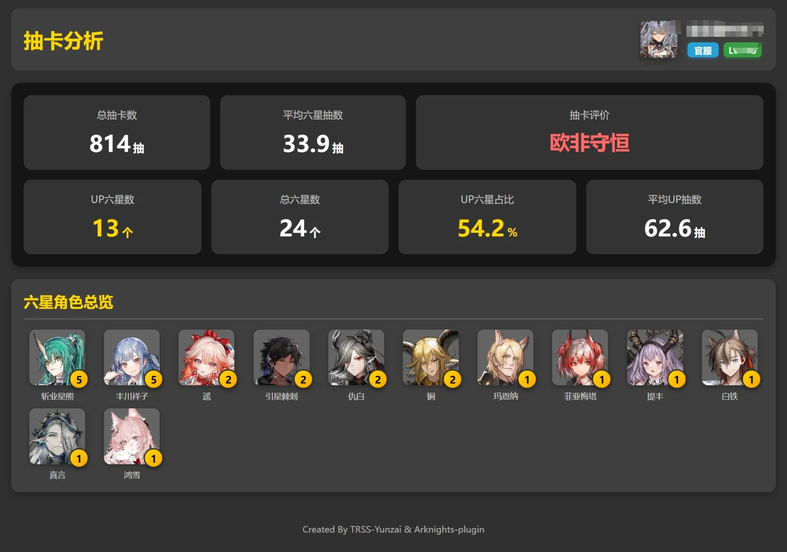](.github/images/recruit-analysis.webp) |

</details>

## 安装与绑定

### 安装插件

在 **Yunzai 根目录**执行，选择一个仓库地址即可。

```bash
# GitHub
git clone --depth=1 https://github.com/gxy12345/arknights-plugin.git ./plugins/arknights-plugin/
pnpm install --filter=arknights-plugin
```

<details>
<summary>使用 Gitee 安装</summary>

```bash
git clone --depth=1 https://gitee.com/windoge/arknights-plugin.git ./plugins/arknights-plugin/
pnpm install --filter=arknights-plugin
```

</details>

安装完成后重启 Yunzai。需要图形化配置时，可配合 Guoba 插件使用。

### 绑定森空岛

使用默认前缀发送：

```text
#方舟帮助
#方舟扫码绑定
#方舟便签
```

也可以发送 `#方舟绑定` 按提示绑定 cred，或通过 `#方舟cred帮助` 查看获取说明。绑定后即可使用便签、签到、干员资产、时装、活动进度和卫戍协议等功能。

### 命令前缀

**以下命令表省略前缀，使用时请添加当前配置的前缀。** 默认模式为 `1`，例如 `#方舟练度卡片`。

| 模式 | 支持形式 | 示例 |
| --- | --- | --- |
| `1`（默认） | `#` 或 `/` + 关键词 | `#方舟帮助`、`/方舟帮助`、`#方舟插件帮助` |
| `2` | `~` 或 `～` | `~帮助`、`～帮助` |
| `3` | 同时支持模式 1、2 | `#方舟帮助`、`~帮助` |

关键词支持 `方舟`、`明日方舟`、`arknights`、`方舟插件`。在 Guoba 或 `config/common.yaml` 中修改 `prefix_mode`，重启后生效。

## 命令指南

<details>
<summary>查看插件帮助菜单效果</summary>

[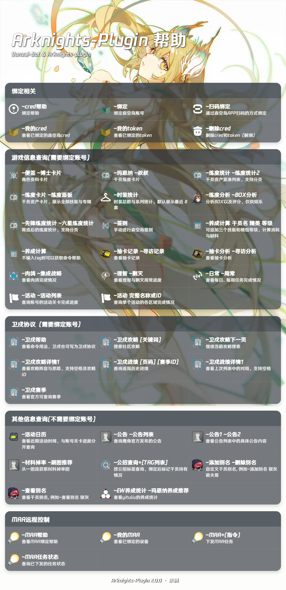](.github/images/help.webp)

</details>

### 日常与账号

| 命令 | 用途 |
| --- | --- |
| `帮助` / `更新` | 打开帮助菜单 / 更新插件 |
| `扫码绑定` / `绑定` | 绑定森空岛账号 |
| `删除cred` / `我的cred` / `我的token` / `cred帮助` | 管理绑定与查看绑定说明 |
| `便签` | 博士个人信息一图流 |
| `签到` | 森空岛签到，支持配置自动签到 |
| `理智` / `剿灭` / `日常` / `周常` | 查询理智、剿灭与任务完成情况 |
| `肉鸽` / `集成战略` | 查询各主题集成战略的完成情况 |
| `抽卡记录` / `寻访记录` | 查询近期寻访记录；可追加卡池名称，如 `抽卡记录 不归花火` |
| `抽卡分析` / `寻访分析` | 查看整体寻访分析 |

### 干员、练度与时装

| 命令 | 用途 |
| --- | --- |
| `玛恩纳` / `叔叔` | 使用干员名称或别名查看个人练度详情 |
| `练度统计` / `练度列表` / `练度查询` | 干员资产列表 |
| `练度卡片` / `练度面板` | 每行五人的干员立绘卡片 |
| `近卫练度统计` / `六星练度卡片` | 按职业或星级筛选；可组合使用 |
| `练度统计2` / `练度卡片2` | 查看第 2 页，页码紧接命令 |
| `练度分析` / `BOX分析` | 分析 BOX 练度数据，仅供娱乐 |
| `时装统计` | 统计全部时装与系列数量，展示最近获得的时装 |
| `养成计算 干员名 精英阶段 等级 技能1 技能2 技能3 模组1 模组2 模组3` | 按当前 BOX 与库存计算养成材料差值 |
| `干员名养成统计` / `干员名养成推荐` | 查询一图流养成统计，支持别名 |
| `添加别名 斩业星熊 新熊` | 添加自定义干员别名 |
| `查看别名 斩业星熊` / `删除别名 斩业星熊 新熊` | 查看或删除自定义别名 |

养成计算的材料明细采用两列图标标签，名称、稀有度和排序优先使用森空岛养成接口，图标按官方材料 ID 加载；资料缺失时使用本地信息兜底。

技能普通等级显示 `1–7`，专精等级显示对应的 `1–3` 专精图标。时装展示数量只影响最近获得卡片，统计总数与系列数量始终按全部已拥有时装计算。

### 卫戍协议

需要绑定森空岛账号；命令中的 `卫戍` 也可写为 `卫戍协议`。

| 命令 | 用途 |
| --- | --- |
| `卫戍帮助` | 查看卫戍协议命令说明 |
| `卫戍攻略 [关键词]` | 查询社区攻略 |
| `卫戍攻略下一页` | 继续当前攻略搜索 |
| `卫戍攻略详情 序号或ID` | 查看成型阵容、回合配置、盟约、装备与操作思路 |
| `卫戍战绩 [页码] [赛季ID]` | 查询逐局历史记录 |
| `卫戍战绩详情 序号` | 查看最近一次战绩列表中的完整阵容与装备 |
| `卫戍赛季` | 查看官方可查询赛季 |

详情命令同时支持 `~卫戍攻略详情 1` 与 `~卫戍攻略详情1`，战绩详情同理（示例使用前缀模式 2 或 3）。战绩列表缓存 5 分钟，查看详情前请先查询战绩列表。

### 活动、资讯与工具

| 命令 | 用途 | 账号要求 |
| --- | --- | --- |
| `活动` / `活动列表` / `活动查询` | 查看账号活动关卡进度 | 需要绑定 |
| `活动 完整名称或ID` | 查看指定活动的区域完成数 | 需要绑定 |
| `活动日历` | 查询近期活动时间 | 无需绑定 |
| `开启活动推送` / `关闭活动推送` | 开关本群活动推送 | 仅主人 |
| `更新活动数据` | 清除活动时间缓存并重新获取 | 仅主人 |
| `公招查询 支援 远程位` | 查询公开招募组合，绑定后可标记持有情况 | 无需绑定 |
| `刷图推荐` / `材料掉率` | 查询一图流材料掉率表 | 无需绑定 |
| `公告` / `公告列表` / `公告1` | 查询公告列表与指定公告内容 | 无需绑定 |

### MAA 远程控制

需另行部署 [MAA 远控 API 服务](https://github.com/gxy12345/maa_control_api)，并在 `config/maa.yaml` 中填写服务信息。

| 命令 | 用途 |
| --- | --- |
| `MAA帮助` | 查看配置与绑定说明 |
| `MAA绑定设备` / `我的MAA` | 绑定或查看设备 |
| `MAA指令` | 下发对应任务，具体指令见帮助 |
| `MAA任务状态` | 查看已下发任务的状态 |

## 配置说明

推荐通过 Guoba 修改配置，也可编辑插件目录下的 `config/*.yaml`。首次启动会从 `defSet` 生成配置；已有用户配置优先于默认值。

| 文件 | 关键配置 | 默认值 / 说明 |
| --- | --- | --- |
| `common.yaml` | `prefix_mode` | `1`，命令前缀模式，修改后重启生效 |
| `game_info.yaml` | `char_stat_page_size` | `30`，练度列表每页数量 |
| `game_info.yaml` | `char_stat_card_page_size` | `35`，练度卡片每页数量，每行 5 名 |
| `game_info.yaml` | `skin_stat_count` | `8`，可选 `4`、`8`、`12`、`16` |
| `sign.yaml` | `auto_sign` / `auto_sign_cron` | 自动签到开关与定时规则 |
| `activity.yaml` | `activity_push_enable` / `activity_push_cron` | 活动推送总开关与定时规则，群推送还需通过命令开启 |
| `maa.yaml` | 远控服务信息 | 配合独立的 MAA 远控 API 使用 |

升级后若仍显示 12 套时装，请检查已有的 `config/game_info.yaml`，将 `skin_stat_count` 改为 `8`。展示数量修改后，下次查询即可生效。

## 致谢

感谢 [StarRail-plugin](https://gitee.com/hewang1an/StarRail-plugin) 的开源实现，以及参与试用与反馈的群友。

数据与素材来自森空岛、明日方舟及一图流等相关来源。本项目采用 [MIT License](LICENSE)。
